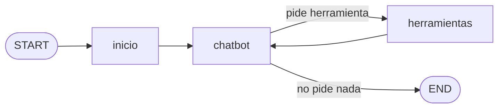

# Observabilidad del asistente del hotel (Langfuse + LangSmith)

Proyecto 6 del máster de AI Engineering de thePower. *English version below.*

En el [proyecto 5](https://github.com/juanmisanchezz/asistente-hotel-langgraph) hice con LangGraph un recepcionista de hotel que funciona en la terminal: contesta directamente o consulta una herramienta (el estado de un ticket o un artículo de ayuda). El problema es que, cuando respondía mal o tardaba, no tenía forma de saber por qué.

En este proyecto lo he conectado a Langfuse y a LangSmith para ver cada paso de cada pregunta: qué le llega al modelo, qué herramienta llama, cuánto tarda y cuánto cuesta. También he guardado dos versiones del prompt en las dos webs para compararlas con las mismas preguntas, y he hecho que los emails y las claves se oculten antes de enviar nada.

Los datos del hotel son inventados. El modelo es Claude Haiku a través de OpenRouter.

## Las trazas



Cada pregunta aparece una sola vez en cada web, con el nombre `asistente-hotel`. Dentro se ve el recorrido entero: la pregunta, cada llamada al modelo con sus tokens y su coste, la herramienta que eligió con lo que le pidió y lo que le devolvió, y la respuesta final.

A cada traza le añado el `query_id` (un identificador por pregunta), la conversación (`thread_id`, que en Langfuse también sirve para agruparla en *Sessions*), el modelo y la versión del prompt con la web de la que se descargó.

Al principio cada pregunta me salía dos veces en LangSmith, porque además de mi oyente estaba activo su registro automático. Lo apagué con `LANGSMITH_TRACING=false`.

Capturas: [Langfuse](capturas/1-langfuse-traza.png) · [LangSmith](capturas/1-langsmith-traza.png)

## Las dos versiones del prompt

La v1 es el prompt del proyecto 5. Para hacer la v2 usé 4 preguntas de prueba (reservar mesa, wifi, cambio de habitación y piscina), distintas de las que luego usé para evaluar. Con la v1 el asistente decía cosas como "soy recepción… pregunte en recepción", no daba una solución concreta y con la piscina daba a entender que el hotel tenía una.

En mi primer intento de v2 escribí "usando el artículo A-30" y el modelo se lo dijo así, tal cual, al cliente. Aprendí que en el prompt hay que explicar qué tiene que hacer y qué no debe decir, no cómo funciona por dentro.

Las dos versiones están subidas a Langfuse y a LangSmith. Al arrancar el chat eliges versión y web, y el prompt se descarga de ahí. Así cada respuesta queda ligada a la versión que la produjo ([captura](capturas/3-traza-con-version.png)).

## Comparación con 10 preguntas

Antes de ejecutar nada escribí los criterios en [criterios.md](criterios.md): una respuesta es un acierto si contesta lo que se pregunta, usa la herramienta cuando toca y no se inventa nada. Las 10 preguntas están en `datos/evaluacion.json` y las pasé con las dos versiones, el mismo modelo, `temperature=0` y una conversación nueva cada vez. Todo queda en `resultados/resultados.csv`.

| | v1 | v2 |
|---|---|---|
| Aciertos | 8/10 | 9/10 |
| Duración media | 3,06 s | 2,45 s |
| Llamadas a herramientas | 9 | 10 |
| Errores | 0 | 0 |
| Tokens | 15.580 | 19.591 |
| Coste | 0,0022 $ | 0,0027 $ |

La v1 falla en la P03 porque añade "le avisaremos en cuanto haya novedades", algo que no está en los datos. Las dos fallan en la P05: cuando el cliente dice "mi ticket número 123", lo convierten en T-123 y responden que no existe, en vez de decirle que el formato no es válido. Eso no lo arregla el prompt; tendría que arreglarlo la herramienta.

La v2 acierta más, pero gasta un 26 % más de tokens y un 19 % más de dinero, porque su prompt es más largo y en la pregunta del parking consulta un artículo más para dar el teléfono de contacto. No es más lenta: la diferencia de tiempos depende sobre todo del proveedor (una sola pregunta de la v1 tardó 9 segundos).

Al principio el coste no salía en ninguna de las dos webs. Tuve que poner a mano el precio de OpenRouter (0,10 $ por millón de tokens de entrada y 0,50 $ de salida) en *Model Definitions* de Langfuse y en *Model Pricing* de LangSmith. Ojo, que solo se calcula para las trazas que llegan después de configurarlo. LangSmith da el mismo coste que mi CSV; Langfuse da un 10 % menos, porque no cobra los tokens de razonamiento.

## Un fallo y un retraso provocados

Añadí dos variables para estropear la herramienta a propósito: `FORZAR_FALLO_HERRAMIENTA=1` hace que lance un error, y `RETRASO_HERRAMIENTA_SEGUNDOS=5` hace que el nodo espere 5 segundos antes de usarla. En los dos casos pregunté por el ticket T-100.

Con el fallo ([Langfuse](capturas/5-langfuse-fallo.png) · [LangSmith](capturas/5-langsmith-fallo.png)), el asistente contesta que no ha podido consultar el ticket. Si se abre el nodo `herramientas`, se ve que `consultar_ticket` devolvió "Error controlado. No se obtuvo información.". La traza no sale en rojo, porque el `try/except` que hice en el proyecto 5 convierte el error en un mensaje y el grafo sigue. Es bueno para el cliente, pero obliga a entrar en el nodo para ver qué ha pasado.

Con el retraso ([Langfuse](capturas/5-langfuse-retraso.png) · [LangSmith](capturas/5-langsmith-retraso.png)), la pregunta tarda 7,72 s en vez de los 4,49 s de la prueba del fallo. El nodo `herramientas` marca 5,01 s, mientras que `consultar_ticket`, dentro de él, marca 0,00 s. O sea, la espera está en el nodo, no en la herramienta.

## Privacidad

En `privacidad.py` hay una función, `ocultar()`, que cambia los emails por `[EMAIL_OCULTO]` y los campos tipo `api_key` o `password` por `[OCULTO]`. En Langfuse la conecto con su opción de masking y en LangSmith con `hide_inputs` y `hide_outputs`.

Lo probé con "Mi email es ana.prueba@ejemplo.com, ¿cómo va mi ticket T-100?" y en las dos webs aparece `[EMAIL_OCULTO]` ([Langfuse](capturas/2-langfuse-email-oculto.png) · [LangSmith](capturas/2-langsmith-email-oculto.png)). Lo que no tapa es lo que el modelo deduce: como el modelo sí ve el mensaje completo, contestó "Hola Ana", y ese nombre sí llega a las trazas. En un caso real habría que filtrar también los nombres.

Las claves están en un archivo local que no se sube al repositorio, y en la metadata solo pongo identificadores técnicos.

Qué guardaría y cuánto tiempo:
- Las trazas, ya sin datos personales, entre 14 y 30 días, solo para revisar errores recientes.
- Las métricas (tiempos, tokens, coste y aciertos de cada versión), sin texto de los clientes, un año, para comparar versiones.
- Emails, teléfonos, nombres de clientes o claves, nunca.

Los proyectos de las dos webs son privados.

## Langfuse o LangSmith

Con las dos llegué al nodo exacto donde estaba el fallo o el retraso. Las diferencias que noté:

- LangSmith enseña por defecto una fila por pregunta y se ve más limpio. Langfuse enseña todos los pasos sueltos, y hay que filtrar por "observación raíz" o ir a *Sessions*.
- Para ver qué paso tarda, en Langfuse uso la vista *Timeline* y en LangSmith *Waterfall*. En LangSmith además tienes la metadata a la vista en el mismo panel.
- En las dos hay que configurar el precio del modelo. Langfuse no tiene en cuenta los tokens de razonamiento.
- Las dos guardan versiones del prompt. LangSmith no deja mover un tag que ya existe, y tuve que borrar y volver a subir el prompt.

Para revisar pregunta a pregunta me quedo con LangSmith; para ver una conversación entera, con Langfuse.

## Otros problemas que me encontré

- El `python3` del Mac era el 3.9 y LangGraph no se instalaba; tuve que crear el entorno con `python3.12`.
- El traductor de Chrome me traducía también el contenido de Langfuse ("ticket" → "billete"). Para las capturas lo desactivé.

## Archivos

```
asistente-hotel-observabilidad/
├── asistente.py            # el chat: grafo del P5, prompts descargados, fallo y retraso
├── trazas.py               # conexión con Langfuse y LangSmith y metadata
├── privacidad.py           # ocultar emails y claves
├── registrar_prompts.py    # sube v1 y v2 a las dos webs (una sola vez)
├── comparar.py             # pasa las 10 preguntas con v1 y v2 y guarda el CSV
├── criterios.md            # criterios de acierto
├── prompts/                # v1.txt y v2.txt
├── datos/                  # tickets, artículos y preguntas de evaluación
├── resultados/             # resultados.csv
├── tests/                  # tests del P5
└── capturas/
```

## Cómo ejecutarlo

```
python3.12 -m venv .venv
source .venv/bin/activate
pip install -r requirements.lock
```

Copia la plantilla de variables del repositorio, rellénala con tus claves de OpenRouter, Langfuse y LangSmith, el `MODEL_ID` y el `LANGSMITH_PROJECT`, y después:

```
python registrar_prompts.py   # solo la primera vez
python asistente.py           # el chat; para salir, "salir"
python comparar.py            # la comparación v1 / v2
python -m unittest discover -s tests
```

---

## English version

In [project 5](https://github.com/juanmisanchezz/asistente-hotel-langgraph) I built a hotel front-desk assistant with LangGraph. Here I connected it to Langfuse and LangSmith so I can see every step of every question: what the model receives, which tool it calls, how long it takes and what it costs.

- Each question shows up once in each platform, with the query id, conversation, model and prompt version. I turned off LangSmith's automatic tracing because it was duplicating runs.
- Two prompt versions live in both prompt managers. The chat downloads the one you choose, so every answer is linked to the version that produced it.
- I wrote the success criteria first and then ran 10 held-out questions with both versions (same model, `temperature=0`). v1 got 8/10 and v2 9/10. v2 costs about 19 % more but is not slower. I had to set the model price by hand in both platforms to see the cost.
- I forced a tool failure and a 5-second delay. Both point to the `herramientas` node: the failure shows up as a controlled error in its output (not red, because of the `try/except`), and the delay as 5.01 s on the node while the tool inside takes 0.00 s.
- Emails and secrets are masked before anything is sent. I tested it with a fake email in both platforms. The model still guessed the name "Ana" from the email, so in a real project names would need filtering too.

```
pip install -r requirements.lock
python registrar_prompts.py
python asistente.py
python comparar.py
```
